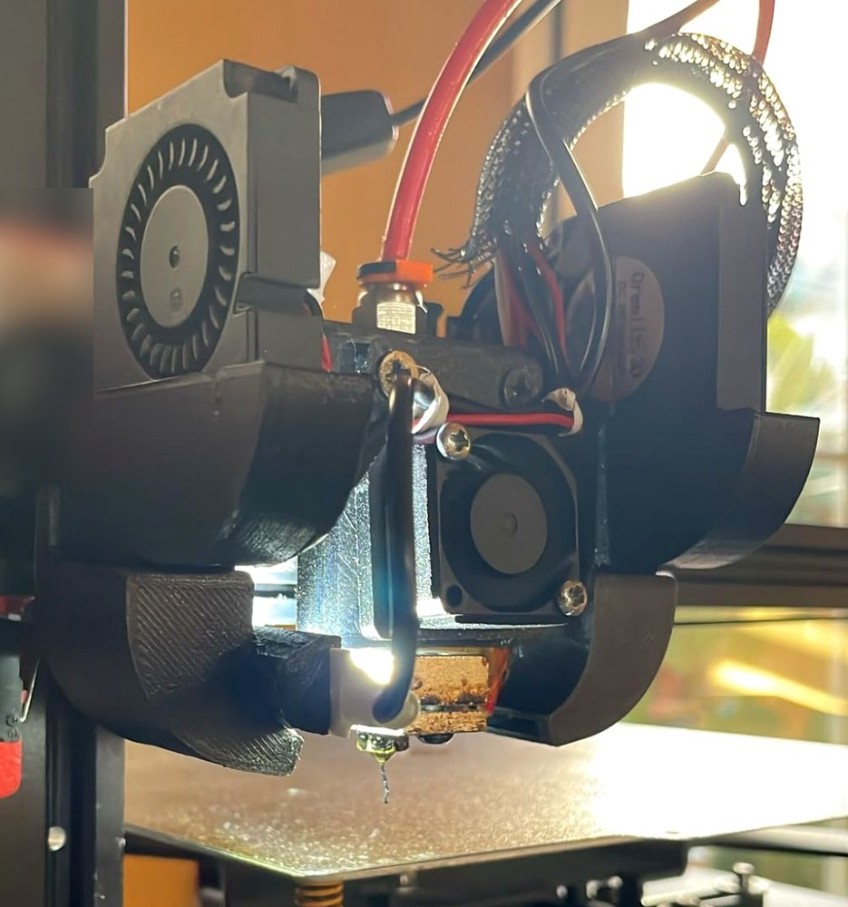
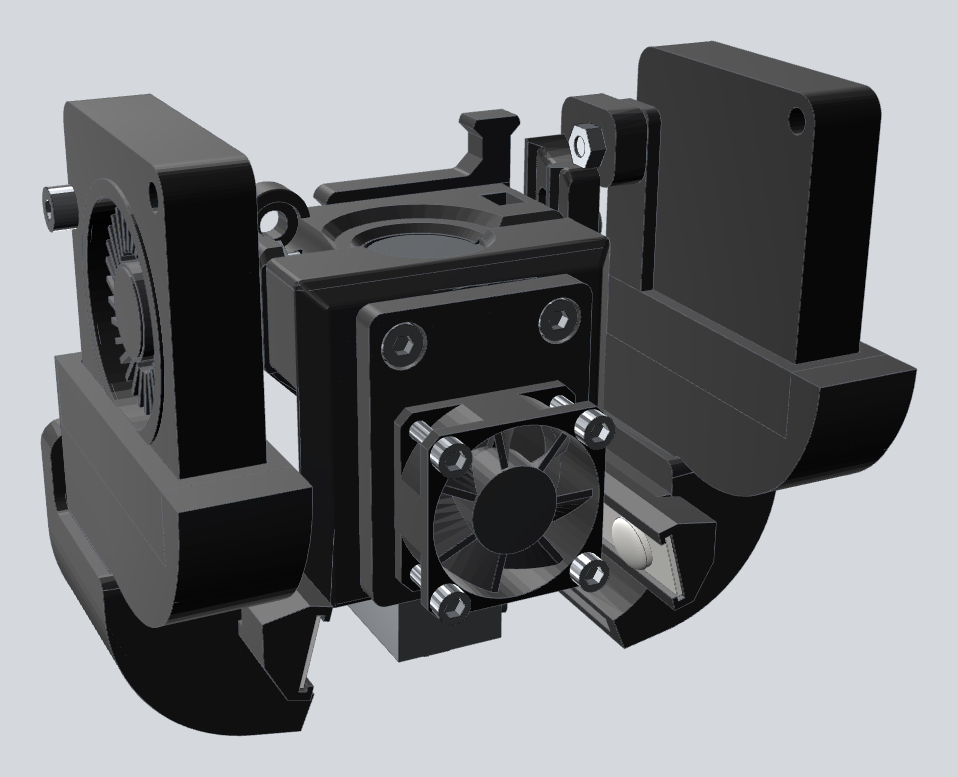
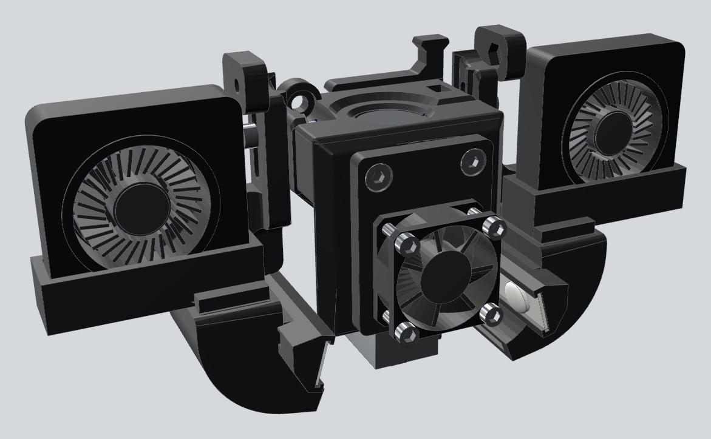
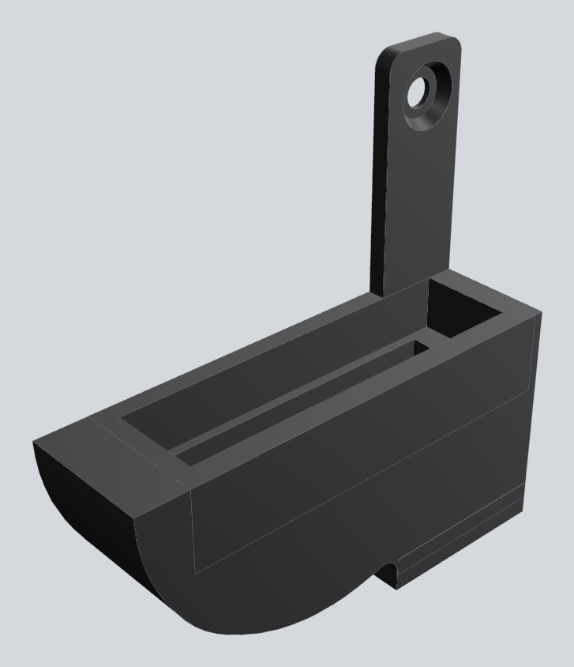
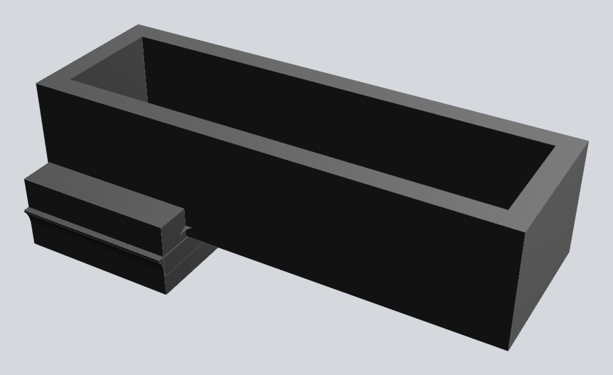
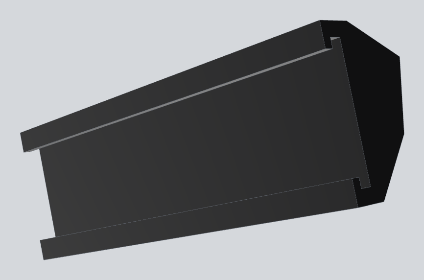
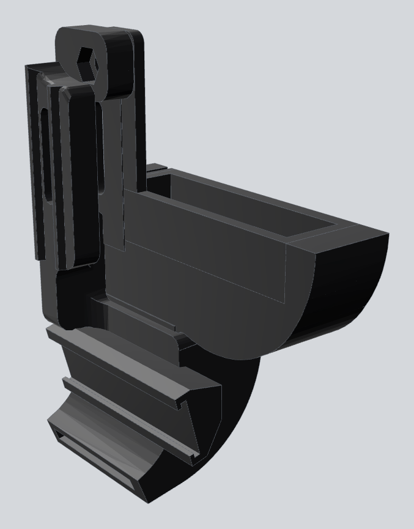
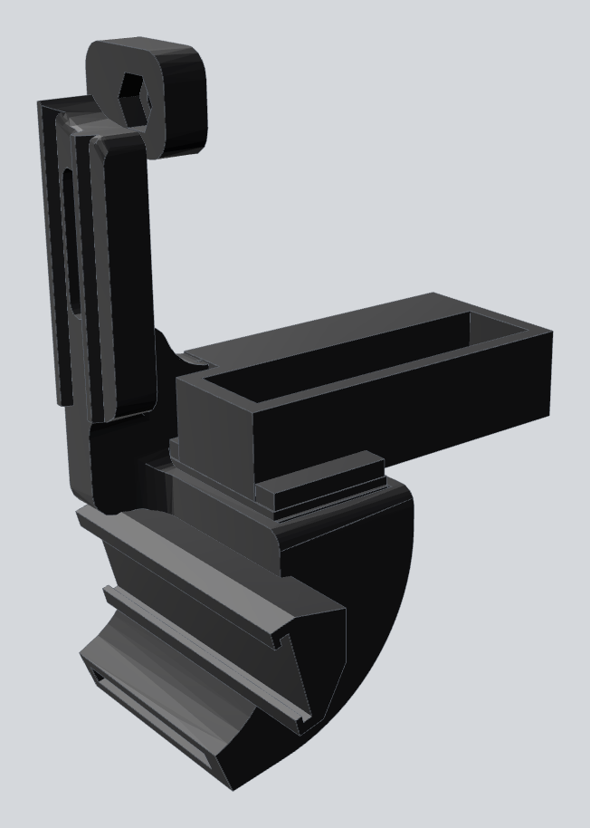
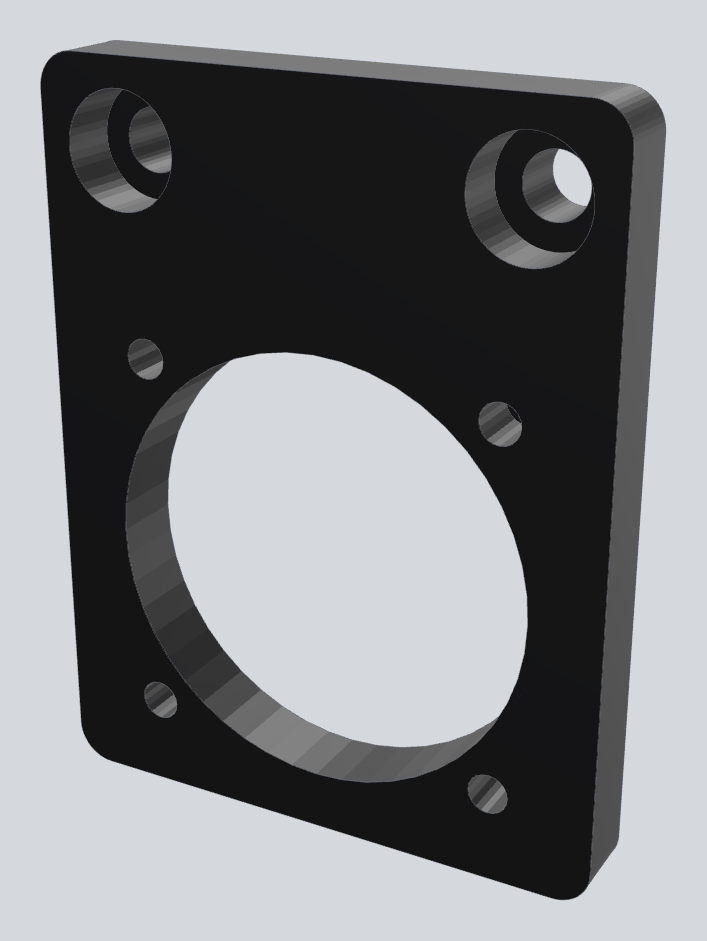
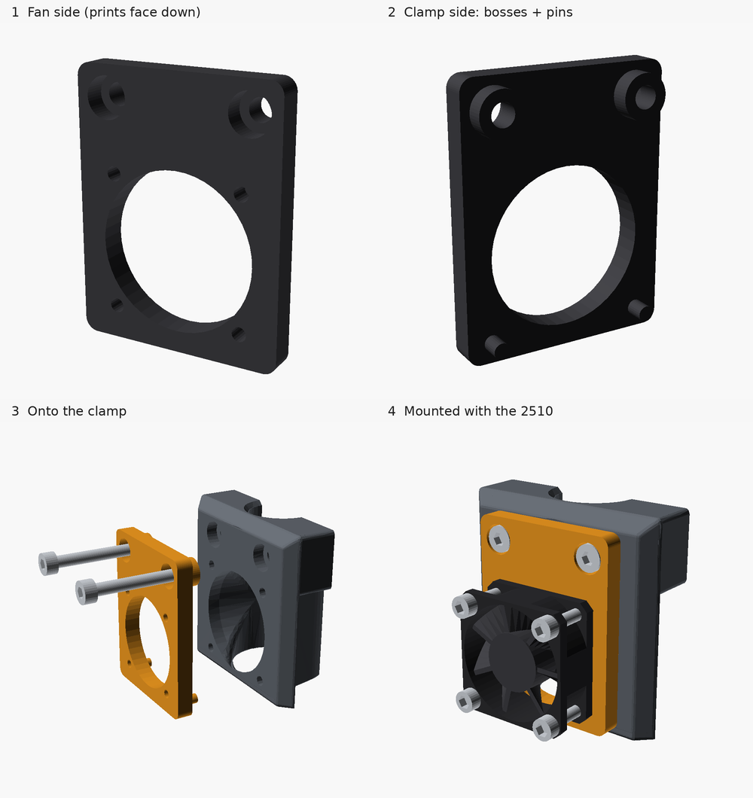

# Igneus V2 for the Anet ET4 — 4010 blowers and LED light

**[Website with the interactive 3D visualizer](https://abarriuso.github.io/igneus-v2-et4-4010-led/)** ·
**[Part generator](https://abarriuso.github.io/igneus-v2-et4-4010-led/generator/)**: enter your measurements and download the STL
(or open `cad-studio/parts/customizer.scad` in OpenSCAD's Customizer)

*Printed and running on an Anet ET4, with the LEDs lighting the nozzle.*

**Remix of [IGNEUS V2 - E3D V6/VOLCANO - ANET ET4 / ET4 PRO / ET4X / ET5](https://www.thingiverse.com/thing:4178590) by Locos3D**,
licensed under [Creative Commons BY-NC-SA 4.0](https://creativecommons.org/licenses/by-nc-sa/4.0/), like the original.

## What this remix adds

- **4010 adapter** to fit the Ender 3's stock 4010 blowers to the original 5015 ducts, in two versions:
  - **Normal**: the blower sits in the original position, held by its mounting screw.
  - **Flat**: the blower sits on top of the adapter with its intake facing the front, like the hotend fan.
    The adapter is only 15 mm tall, so the blowers sit low.
- **LED mount** that fits on the inside of each original duct, held with a zip tie, and aims two LEDs of a
  24 V LED strip with one lensed LED per segment, like the light strips sold for the Bambu Lab A1, at the nozzle.
- **One-piece duct** with the 4010 adapter and the LED channel built in, in both versions, if you prefer to reprint
  the ducts.
- **25 → 30 mm fan adapter** so the 2510 hotend fan of an Anycubic Kobra X fits Locos3D's 30 mm fan clamp.

| Normal | Flat |
|---|---|
|  |  |

## Downloads

All files are oriented for printing. Right and left parts are mirror images.

| | Part | Download | Printing |
|---|---|---|---|
|  | 4010 adapter, normal | [right](cad-studio/export/Adapter_4010_right.stl) · [left](cad-studio/export/Adapter_4010_left.stl) | Nozzle down, supports from the build plate |
|  | 4010 adapter, flat | [right](cad-studio/export/Adapter_4010_flat_right.stl) · [left](cad-studio/export/Adapter_4010_flat_left.stl) | Upside down, no supports |
|  | LED mount for the original duct | [right](cad-studio/export/LED_mount_right.stl) · [left](cad-studio/export/LED_mount_left.stl) | No supports |
|  | One-piece duct with LED channel, normal | [right](cad-studio/export/Duct_4010_LED_right.stl) · [left](cad-studio/export/Duct_4010_LED_left.stl) | On its flat back face |
|  | One-piece duct with LED channel, flat | [right](cad-studio/export/Duct_4010_LED_flat_right.stl) · [left](cad-studio/export/Duct_4010_LED_flat_left.stl) | On its flat back face, supports under the front wall of the fan cradle |
|  | 2510 fan to the 30 mm fan clamp | [download](cad-studio/export/Fan_adapter_2510_30mm.stl) | Fan side down, no supports |

Assembly notes:

- **LEDs**: on this kind of strip each LED is its own segment. Cut it at the marks, two LEDs per side, and wire both
  pieces in parallel to 24 V.
- **2510 fan adapter**: it is held by the clamp's own two M3 screws, which need to be about **4 mm longer**, and the
  fan is fixed with 4 self-tapping M2.5 screws.

## Original parts

Everything else is Locos3D's original Igneus V2: **[download it from Thingiverse](https://www.thingiverse.com/thing:4178590)**
([assembly guide](https://cults3d.com/en/3d-model/various/igneus-mounting-guide-on-anet-et4-et5)). This build uses:

| File | Qty | What it is |
|---|---|---|
| `Igneus_Version1_Rev.3.stl` | 1 | Body for the E3D V6 |
| `Abrazadera_Adapter_Fan_30mm.stl` | 1 | Front clamp with the 30 mm fan mount |
| `Tobera_5015_V2.stl` | 2 | 5015 duct, one of them mirrored for the left side (not needed with the one-piece ducts) |

## License

Remix of IGNEUS V2 by [Locos3D](https://www.thingiverse.com/thing:4178590), shared under
[CC BY-NC-SA 4.0](https://creativecommons.org/licenses/by-nc-sa/4.0/): credit Locos3D, non-commercial use only,
and share any derivative under the same license.
